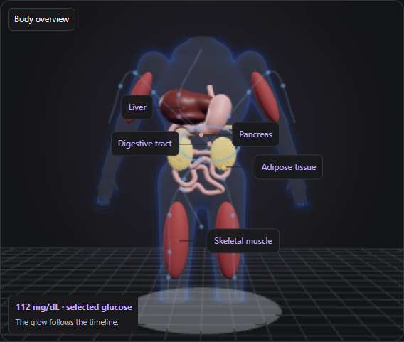
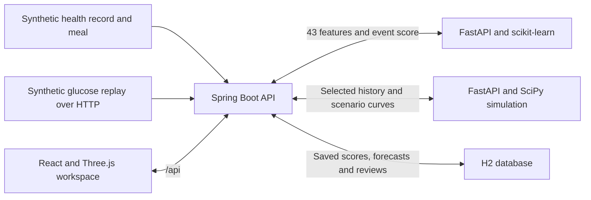

# GlucoTwin

GlucoTwin is a research prototype for reviewing **glucose after a meal**. It brings a synthetic health record, meal details and replayed glucose sensor readings into one patient workspace. The fitted model returns a score for a defined event within 120 minutes. A reviewer can inspect the leading factors, check later readings and export the saved result.

[Competition slides](deliverables/glucotwin_competition_demo.pptx) · [Architecture](docs/ARCHITECTURE.md) · [Local setup and presentation script](docs/CONNECTED_LOCAL_DEMO.md#competition-walkthrough) · [Model card](docs/MODEL_CARD.md)

## What the demo shows

1. Choose one of two synthetic patients. Each starts with nine glucose readings and a recorded meal.
2. Move through the glucose timeline. **View patient twin** opens the 3D anatomy and shows the selected reading. The illustrated view can be used on systems with limited graphics.
3. Choose **At the meal**, then **Score & save meal**. The score and leading model factors are saved with the exact inputs used. Moving through later readings leaves the saved result tied to the original meal.
4. Replay the synthetic follow-up, add a review note and **Download saved result**. The PDF contains the saved result ID, model version, input fingerprint and review.

**Glucose forecast at selected reading** is a separate meal-and-walk simulation. It compares two curves from the same starting point and uses default parameters for the short synthetic recording. The custom meal form produces a separate research score. The **Future lab** uses scripted scenarios to illustrate possible interactions. [Forecast details](docs/TWIN_INTEGRATION.md) · [Custom meal scoring](docs/MEAL_SIMULATOR.md) · [Future lab](docs/VISUAL_TWIN_AND_PROJECTION.md)

## How it works

The dashboard uses React, TypeScript, Vite and Three.js. The API runs on Java 21 and Spring Boot. The Python service runs the fitted logistic regression and the separate physiological simulation. [API contract](docs/API_CONTRACT.md) · [Feature dictionary](docs/FEATURE_DICTIONARY.md) · [Synthetic data dictionary](docs/DATA_DICTIONARY.md)

## Target and model evidence

The model scores whether glucose reaches **180 mg/dL or higher** or rises **40 mg/dL or more above the meal-time baseline** during the next 120 minutes. The event score is uncalibrated. The anatomical view illustrates organ locations and the selected glucose reading. The prototype is for research demonstrations.

The classifier was evaluated on **493 held-out meals from 15 patients**, with no patient shared across training and test sets.

| Metric | Fitted model | Baseline |
| --- | ---: | ---: |
| ROC AUC | 0.757 | 0.500 |
| Balanced accuracy | 0.673 | 0.500 |
| F1 | 0.742 | 0.757 (always predicts the event) |

At the 0.50 threshold, the classifier missed 78 of 300 test events and flagged 76 non-events. Independent validation and calibration are still needed. [Model card](docs/MODEL_CARD.md) · [Prediction target](docs/CLINICAL_SCOPE.md)

## Run and verify

Use the [native Windows setup and presentation script](docs/CONNECTED_LOCAL_DEMO.md#competition-walkthrough). It builds the services, replays both synthetic histories and checks that the dashboard reaches the fitted model. Once the services are running, open the [local workspace](http://127.0.0.1:5173/?patient=DEMO-001#workspace).

The compiled dashboard completed the local rehearsal on 22 November 2026. DEMO-001 returned **0.368** and DEMO-002 returned **0.989**. The rehearsal checked the PDF against the saved result and confirmed that reviews and forecasts survived a backend restart. The production frontend build, 31 Java tests and 27 Python tests passed. [Verification notes](docs/CONNECTED_LOCAL_DEMO.md#competition-verification-22-november-2026)

[Docker Compose](compose.yaml) is included for assembly. An earlier revision passed isolated Docker acceptance. A clean container rebuild for this revision, a physical phone check and public hosting remain open. [Earlier acceptance evidence](docs/MVP_ACCEPTANCE.md) · [Stabilization notes](docs/STABILIZATION_STATUS.md)

## Data, credits and license

The demo patients, meals and live glucose replay are synthetic. The fitted classifier used meal windows derived from ShanghaiT2DM. Participant-level research data stays outside the demo repository. [Data sources and attribution](docs/DATA_LICENSE_AND_ATTRIBUTION.md) · [Training pipeline](docs/SHANGHAI_T2DM_PIPELINE.md)

The physiological simulation builds on an MIT-licensed glucose model, and the worklist and glucose metrics draw on prior work documented in [Upstream twin code](docs/UPSTREAM_TWIN_CODE.md). The project source is available under the [MIT license](LICENSE).
