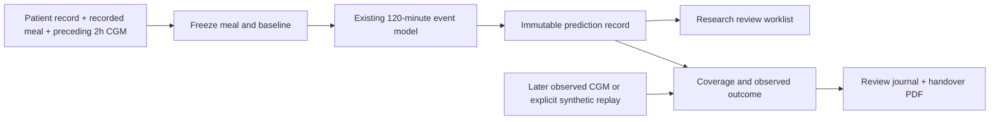

# GlucoTwin: repository review and bounded product direction

Review date: 1 November 2026. This is a research/design recommendation. It does not implement a new clinical feature, retrain the model, change the prediction target, or prove reduced staff workload.

Implementation update: the worklist and journal recommended here were subsequently implemented; see [Workflow Guide](WORKFLOW_GUIDE.md). The audit and assessment below preserve the state observed **before that implementation**, including the then-existing storage/timestamp gaps. Model metrics and target are unchanged.

## Recommended end product

**A research prototype for reviewing a patient's recorded meal, the model's next-two-hour event score, and the glucose response subsequently observed.**

Build two connected capabilities: (1) a multi-patient/meal review worklist using the existing event predictor, and (2) a prediction-and-outcome journal that supports follow-up and handover. There is one predictive target in this release; the journal is observed-outcome tracking. Benefits to doctors and nurses are proposed workflow benefits that still need usability testing and clinical validation.

Meal selection, food substitution and prevention claims are not established capabilities. The 3D body explains biology; it does not calculate or validate predictions.

## What the current project actually supports

| Area | Verified from current source |
|---|---|
| Public input | Two synthetic patient/meal fixtures; nine readings at 15-minute offsets over the preceding 120 minutes, ending at the meal baseline. HTTP replay, no physical sensor or MQTT dependency. |
| Predictor | One fitted logistic-regression pipeline with 43 inputs and one fixed 120-minute horizon. Not a glucose-value regressor, multi-horizon forecaster, low-glucose predictor or food-response simulator. |
| Target | Any observed future glucose >=180 mg/dL **OR** rise >=40 mg/dL from baseline during the next 120 minutes. The research preparation script uses future samples strictly after baseline through the horizon endpoint. |
| Patient population behind training | ShanghaiT2DM-derived meals; patient-separated train/validation/test groups. A Type 1 model from another repository cannot inherit this population fit. |
| Output | Uncalibrated score, threshold flag, model version and leading numerical model contributions. Contributions are associations, not causal dietary advice. |
| Application | Spring Boot/H2, FastAPI/scikit-learn, React/TypeScript/Vite; educational Three.js anatomy/tour and browser-generated research PDF. |
| Storage | H2 stores CGM. PredictionService keeps only the latest prediction per patient in an in-memory map; no durable meal/prediction/outcome journal exists. |
| Timestamp binding | FeatureBuilder takes the latest reading as baseline. The prediction response has no inference timestamp, meal ID or baseline-to-score identifier. Appending post-meal readings without a frozen baseline would move the prediction point. |
| Real research path | Separate local provenance/history validation only; no real-derived inference, public upload UI or clinical deployment. |
| Completion boundary | Module implementation/independent tests are prepared. Final Spring/ML assembly and export acceptance remain in the 2 November checklist. |

Local ground truth: `CLINICAL_SCOPE.md`, `MODEL_CARD.md`, `FEATURE_DICTIONARY.md`, `MODULE_PLAN.md`, `research/README.md`, `ml-service/app/main.py`, `PredictionService.java`, `PredictionResponse.java`, `FeatureBuilder.java`, `PatientController.java` and current dashboard/report code. No application/model files were changed by this review.

## Repositories screened and inspected

Both pages of the user-provided [glucose-prediction topic](https://github.com/topics/glucose-prediction?o=asc&s=forks) were screened. Repository lists and ordering change over time. The focused review below inspected selected READMEs, configuration, evaluation code or persistence code; it was not an exhaustive executable audit of every repository. No external project was installed, run, or copied into GlucoTwin.

| Repository | Evidence inspected | Useful lesson and fit decision |
|---|---|---|
| [GluPredKit](https://github.com/replicahealth/GluPredKit) | README, glycemia-detection metric, zero-order and linear-trend baselines, plot docs; [JOSS software paper](https://joss.theoj.org/papers/10.21105/joss.06904) | Best evaluation reference: compare forecasts with simple baselines and inspect event errors. Its numerical forecasts are not interchangeable with our classifier. Error-grid/RMSE evaluation needs actual predicted glucose values, not a 0-1 event score. |
| [PostprandialHyperHypoPrediction](https://github.com/r-cui/PostprandialHyperHypoPrediction) | README, `src/config.yaml`, dataset preparation helper | Closest research question. Configuration separates high-glucose assessment at 0-2 hours and low-glucose assessment at 2-4 hours on OhioT1DM. Useful distinction; not a ready-made two-hour low-glucose feature for our Type 2 data. |
| [toolsaaps](https://github.com/siriushex/toolsaaps) | README, `MealForecastJournalEntity.kt`, `MealProspectiveWindowAudit.kt` | Strong workflow inspiration: retain prediction/context timestamps and source/version; evaluate only later observations with explicit quality handling. Window-audit code explicitly does not claim verified observation coverage. Its therapy automation is outside GlucoTwin scope. |
| [GlucoSenseAI](https://github.com/Prajwaln08/GlucoSenseAI) | README, `src/data/eligibility.py`, `scripts/evaluate_baselines.py` | Availability gates and matched evaluation baselines are useful. The inspected eligibility code requires watch coverage and gives one tier no held-out test days; the evaluator explicitly uses validation for that tier. Do not import its broad performance claims or dependencies as evidence for GlucoTwin. |
| [cgm_format](https://github.com/GlucoseDAO/cgm_format) | README and repository inventory | Future input-adapter reference: vendor formats, units, original timestamps and quality flags. Its processing/interpolation policy must be reviewed against our causal, 15-minute, pre-meal contract before reuse. It does not make our model clinically accurate. |
| [GlucoCast](https://github.com/VivaanGupta17/glucocast) | README, Ohio configuration and LICENSE | Multi-horizon/uncertainty ideas, but the inspected configuration expects six hours of five-minute history plus insulin/carbohydrate/activity context. Its license includes a research-only clinical disclaimer. Not a compatible model drop-in; README results were not reproduced. |
| [GLYFE](https://github.com/dotXem/GLYFE) | README and metric/source inventory | Benchmarking reference for Type 1 glucose forecasting. Its simulator branch requires licensed MATLAB/T1DMS; do not add those dependencies to this prototype. |
| [GlucoBench](https://github.com/IrinaStatsLab/GlucoBench) | README, dataset/benchmark organization | Later external-evaluation reference; dataset populations, frequency and individual usage terms must be checked. Do not combine cohorts or adopt published metrics as our own. |

GluPredKit, the postprandial paper repository and cgm_format report MIT code licensing. No root license was identified by GitHub metadata for toolsaaps/GlucoSenseAI/GLYFE in this review; do not copy their code without establishing permission. The recommendations here are independently specified product patterns, not a plan to vendor their source. Dataset permissions are separate from code licenses.

API heads observed during the review: GluPredKit `12c70117c48eca54e920a0af69746949922407c1`; PostprandialHyperHypoPrediction `a9dc44bc1e9ba2421ee2f18ce26d5e704eecbcbd`; toolsaaps `973c0917bab1cad1002a44f0048e0a628ba432c5`; GlucoSenseAI `d6d14b903d1968bf081bc4013d92238bebf53172`; cgm_format `a2592641156b041bf0f7b44b274f9e30af0d4064`; GlucoCast `dc63b7a80276e8e8b47460db0afe57339688b6be`; GLYFE `97b3198d48e1dc14ca07f63de202ece49990db82`. Raw main-branch files were inspected during the same review; this is an observation log, not a vendored immutable checkout.

## Feasibility audit of our existing data

The review also read the original local prepared research tables, producing **aggregate counts only**. No participant records were copied into this project, no inference was executed, and no model was trained. Reproducible script: `research/audit_scope_feasibility.py`. Source hashes and aggregate output: [scope_audit_2026-11-01.json](research/scope_audit_2026-11-01.json).

| Finding | Train | Validation | Test |
|---|---:|---:|---:|
| Existing eligible meal rows | 1,871 | 451 | 493 |
| Baseline already >=180 mg/dL | 233 | 82 | 102 |
| Composite positive labels | 1,212 | 316 | 300 |
| Future absolute >=180 labels | 876 | 240 | 234 |
| Positive only through the >=40 rise rule, without reaching 180 | 336 | 76 | 66 |
| Complete eight future samples at +15 through +120 minutes | 1,869 | 451 | 493 |
| Complete windows with any observed glucose <70 mg/dL | 28 | 35 | 21 |
| Patients contributing those low-containing windows | 14 | 6 | 5 |

These are meal-window counts, potentially overlapping, not counts of independent hypoglycemic episodes. The low-window audit concerns this exact two-hour meal task; it does not establish that the entire underlying continuous dataset lacks other low-glucose examples. The 2-4-hour target used by the external postprandial repository was not audited here.

Consequences:

1. **Do not call the composite output a pure hyperglycemia prediction.** Sixty-six test positives meet only the rise rule. Separate observed components can be shown after follow-up, but the current score cannot be decomposed into separate probabilities. Predicting the components separately requires new fitted/evaluated models.
2. **Show existing high glucose separately.** 102/493 test meals (20.7%) already start >=180. A high current value is an observation, not proof of advance-warning skill.
3. **Inspect the harder subgroup.** Existing test predictions reproduce 117 TN / 76 FP / 78 FN / 222 TP overall. Among 391 meals starting below 180: 117 TN / 75 FP / 73 FN / 126 TP. Descriptive recall is 126/199 = 63.3%, compared with 74.0% overall. This post-hoc subgroup audit is not fresh validation and must not be used to tune against the test set.
4. **Defer low-glucose prediction.** Twenty-eight positive training meal windows and marked split differences warrant a dedicated data/label study and patient-separated evaluation before adding that product claim. Copying Type 1 weights or adding a low threshold to a high-event classifier does not solve it.
5. **Resolve a documentation question.** 1,828/2,815 = 64.9% describes all eligible meals together; 300/493 = 60.9% describes the test split. Existing source metadata confirms the different denominators. This review records the distinction without editing the deck or changing metrics.

The published classifier evidence still applies: ROC AUC 0.757, balanced accuracy 0.673, F1 0.742 versus always-positive F1 0.757. Calibration, external validation and clinical benefit remain unestablished.

## Capability 1: post-meal research review worklist

**Question:** Which recorded meals have a model flag to inspect, which patients already have a high baseline, and which records cannot be scored?

**Prediction:** Retain the exact existing composite next-120-minute event. Do not invent a clinical priority score or relabel it a calibrated probability.

**Proposed staff-facing view:** One row per patient/meal with baseline value and time, meal, score/status, horizon end, model version, data completeness, review state and an explanation link. Display current glucose >=180 separately from the model flag. Unavailable, incomplete, superseded and awaiting-review records stay visible; a low score is never labelled safe. This is a research worklist, not an emergency-triage system.

**Proposed benefit:** Fewer separate screens to inspect and a clearer record of which result has been reviewed. We have not measured time saved or clinical outcomes.

**Current gap:** The dashboard selects one of two synthetic scenarios and stores no acknowledgement or durable prediction snapshot. Data quality also needs a named status: the research validator requires nine exact offsets, whereas the runtime builder checks total count and four exact lag positions. History failures currently fall into a generic unavailable error. Distinguish insufficient/invalid history from model outage rather than implying both are the same problem.

**Acceptance:** Every row has a frozen baseline/meal identity; source-data age is distinct from score age; replay time is explicit; unavailable cannot appear low-risk; refresh creates a new result without overwriting the audit record; patient switches and mixed response timing cannot cross-link records.

## Capability 2: prediction/outcome journal for follow-up and handover

**Question:** What was predicted at the meal, what was actually observed afterward, and has someone reviewed the discrepancy?

This capability calculates observed follow-up summaries; it is **not a second prediction model**. Save each prediction before future observations exist. Later associate only that meal's next-120-minute readings and show observed maximum, maximum rise from the original baseline, the two observed target components, coverage and whether the pre-existing model flag matched the recorded outcome. Include a timestamped manual review note in the synthetic demo.

Use states such as awaiting outcome, event observed, no event observed with complete sampled coverage, insufficient follow-up and superseded prediction. If samples are missing and no event has been seen, the outcome is unknown. A positive observed sample can establish an observed event even in an incomplete window, but cannot establish the peak or complete coverage. Even all eight 15-minute samples cannot prove that no threshold crossing occurred between samples.

**Proposed benefit:** A research handover can show the prediction, the actual response and unresolved follow-up together, rather than asking the next reviewer to reconstruct the timeline. Repeated meals can be reviewed descriptively; this does not prove a food caused an event or establish a better replacement meal.

**Implementation boundary:** Add durable `mealId`, `predictionId`, `baselineAt`, `computedAt`, horizon, model/input version or hash, immutable input snapshot, status and score. Store source observation time and arrival time separately if simulating prospective delivery. Keep outcome observations separate from model features. Add a controlled synthetic post-meal replay; public fixtures currently contain history only. Never regenerate the original prediction from future observations or silently move its baseline.

**Acceptance:** Freeze before outcomes arrive; late readings are identified; no future-data leakage; partial windows cannot imply a negative outcome; repeated review cycles are traceable; replay restart is idempotent; observed versus predicted values are clearly labelled; PDF refers to the same saved result ID and baseline. Any before/after intervention comparison remains observational and cannot support a prevention claim.

## Bounded candidate if we later require another prediction output

The prepared meals already contain separate labels for reaching >=180 and rising >=40 within the same 120-minute window. Training has 876 absolute-high positive meals and 984 rise-positive meals, compared with 28 complete windows containing a low sample in this audit. A future model study could fit two independently evaluated classifiers using the existing pre-meal feature contract, with observed baseline-high status still separate. These outputs overlap and are not mutually exclusive categories.

This would make the model questions more specific without requiring a new device or a Type 1 model. It would not establish which alternative meal is better, calibrate the scores, or prove clinical benefit. The existing combined score cannot be split arithmetically into those two predictions. Treat this as a later model-version proposal, after the review workflow works and a new evaluation plan is agreed; it is not an additional accepted deliverable for the current assembly.

## Scope and implementation order



1. Complete the already-scheduled assembly checks for the current modules. These recommendations do not claim those checks passed or require an unreviewed scope expansion before the deadline.
2. Implement baseline/meal identity and immutable prediction records first. This is required for either proposed feature; it resolves the timestamp limitation already printed in our PDFs.
3. Build the worklist against synthetic snapshots and verify status/freshness handling independently.
4. Add synthetic post-meal observations and observed-outcome matching without modifying the fitted model. Verify the journal independently, then perform assembled acceptance.
5. Before any genuine second prediction task, agree on target/population/horizon, check label support, define a new patient-separated evaluation plan and compare with simple baselines. Freeze a new holdout if developing repeatedly after inspecting this test split.

Keep the existing stack and 120-minute horizon. No smartwatch, sensor account, MQTT, cloud database, chatbot or deep-learning replacement is needed for the two recommended capabilities.

Deferred product claims: low-glucose prediction, exact 30/60/120-minute glucose curves, alternative-meal optimization, insulin/medication advice, emergency alerts, predicted organ dysfunction, full physiological simulation, complication prevention and clinical deployment. CGM-format import can be a later research adapter, without making the public demo accept real patient data.

Two-hour snapshots also do not establish the longer-term CGM pattern metrics used in clinical management. [ADA 2026 guidance](https://doi.org/10.2337/dc26-s006) describes longer collection periods and individualized goals; do not market our nine samples as a clinical time-in-range assessment or a universal treatment threshold.

## Specific source links for follow-up

- [Postprandial target windows and thresholds](https://github.com/r-cui/PostprandialHyperHypoPrediction/blob/main/src/config.yaml)
- [GluPredKit event-region evaluation](https://github.com/replicahealth/GluPredKit/blob/main/glupredkit/metrics/glycemia_detection.py): its >180 boundary differs from our >=180; adapt deliberately.
- [GluPredKit zero-order baseline](https://github.com/replicahealth/GluPredKit/blob/main/glupredkit/models/zero_order.py) and [linear-trend baseline](https://github.com/replicahealth/GluPredKit/blob/main/glupredkit/models/naive_linear_regressor.py): five-minute forecasting examples, not compatible classifier outputs.
- [toolsaaps timestamped meal forecast journal](https://github.com/siriushex/toolsaaps/blob/main/android-app/app/src/main/kotlin/io/aaps/copilot/data/local/entity/MealForecastJournalEntity.kt)
- [toolsaaps prospective observation audit](https://github.com/siriushex/toolsaaps/blob/main/android-app/app/src/main/kotlin/io/aaps/copilot/domain/meal/MealProspectiveWindowAudit.kt)
- [GlucoSenseAI availability gates](https://github.com/Prajwaln08/GlucoSenseAI/blob/main/src/data/eligibility.py) and [matched-baseline evaluation](https://github.com/Prajwaln08/GlucoSenseAI/blob/main/scripts/evaluate_baselines.py)
- [cgm_format schema and quality tracking](https://github.com/GlucoseDAO/cgm_format#unified-format-schema)
- [GlucoCast five-minute/six-hour configuration](https://github.com/VivaanGupta17/glucocast/blob/main/configs/ohio_config.yaml) and [research disclaimer](https://github.com/VivaanGupta17/glucocast/blob/main/LICENSE)

To reproduce the local aggregate audit, with the original prepared export available:

```powershell
cd D:\3Nov
python -B research/audit_scope_feasibility.py --processed-root C:/Users/subha/Downloads/happyhealth-digital-twin-data-v1/data/processed/shanghai-t2dm --output docs/research/scope_audit_2026-11-01.json
```

The audit performs no network requests, model loading, training, or source-record copying. The JSON contains aggregate counts and source-file hashes only. External repository inspection was read-only and no clinical workflow was run.
